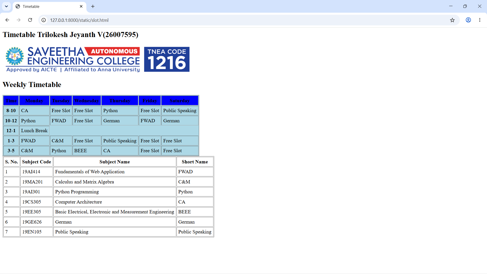

# Ex02 Time Table
## Date:17.11.2026

## AIM
To write a html webpage page to display your slot timetable.

## ALGORITHM
### STEP 1
Create a Django-admin Interface.

### STEP 2
Create an App inside the Django project.

### STEP 2
Create a static folder uder the created App and insert HTML code.

### STEP 3
Create a simple table using ```<table>``` tag in html with the relevant attributes.

### STEP 4
Add rows using ```<tr>``` tag.

### STEP 5
Add your course schedule using ```<td>``` tag.

### STEP 6
Execute the program using runserver command.

## PROGRAM
```
<html>
<head>
    <title> Timetable</title>
</head>
<body>

    <h2>Timetable Trilokesh Jeyanth V(26007595)</h2>

    

    <h2>Weekly Timetable</h2>

    <table border="1" cellpadding="5" bgcolor="lightblue">
        <tr bgcolor="blue">
            <th>Time</th>
            <th>Monday</th>
            <th>Tuesday</th>
            <th>Wednesday</th>
            <th>Thursday</th>
            <th>Friday</th>
            <th>Saturday</th>
        </tr>
        <tr>
            <th>8-10</th>
            <td>CA</td>
            <td>Free Slot</td>
            <td>Free Slot</td>
            <td>Python</td>
            <td>Free Slot</td>
            <td>Public Speaking</td>
        </tr>
        <tr>
            <th>10-12</th>
            <td>Python</td>
            <td>FWAD</td>
            <td>Free Slot</td>
            <td>German</td>
            <td>FWAD</td>
            <td>German</td>
        </tr>
        <tr>
            <th>12-1</th>
            <td colspanv="6">Lunch Break</td>
        </tr>
        <tr>
            <th>1-3</th>
            <td>FWAD</td>
            <td>C&M</td>
            <td>Free Slot</td>
            <td>Public Speaking</td>
            <td>Free Slot</td>
            <td>Free Slot</td>
        </tr>
        <tr>
            <th>3-5</th>
            <td>C&M</td>
            <td>Python</td>
            <td>BEEE</td>
            <td>CA</td>
            <td>Free Slot</td>
            <td>Free Slot</td>
        </tr>
    </table>

    

    <table border="1" cellpadding="5">
        <tr>
            <th>S. No.</th>
            <th>Subject Code</th>
            <th>Subject Name</th>
            <th>Short Name</th>
        </tr>
        <tr>
            <td>1</td>
            <td>19AI414</td>
            <td>Fundamentals of Web Application</td>
            <td>FWAD</td>
        </tr>
        <tr>
            <td>2</td>
            <td>19MA201</td>
            <td>Calculus and Matrix Algebra</td>
            <td>C&M</td>
        </tr>
        <tr>
            <td>3</td>
            <td>19AI301</td>
            <td>Python Programming</td>
            <td>Python</td>
        </tr>
        <tr>
            <td>4</td>
            <td>19CS305</td>
            <td>Computer Architecture</td>
            <td>CA</td>
        </tr>
        <tr>
            <td>5</td>
            <td>19EE305</td>
            <td>Basic Electrical, Electronic and Measurement Engineering</td>
            <td>BEEE</td>
        </tr>
        <tr>
            <td>6</td>
            <td>19GE626</td>
            <td>German</td>
            <td>German</td>
        </tr>
        <tr>
            <td>7</td>
            <td>19EN105</td>
            <td>Public Speaking</td>
            <td>Public Speaking</td>
        </tr>
    </table>

</body>
</html>
```

## OUTPUT


## RESULT
The program for creating slot timetable using basic HTML tags is executed successfully.
